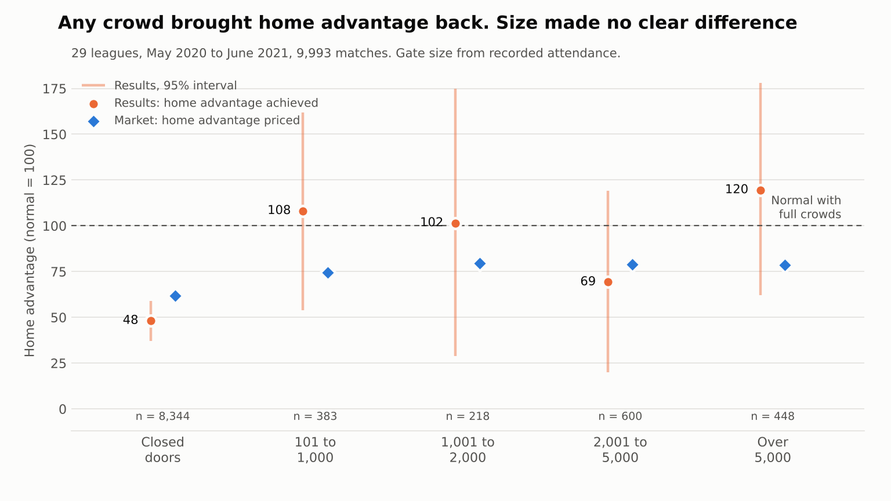
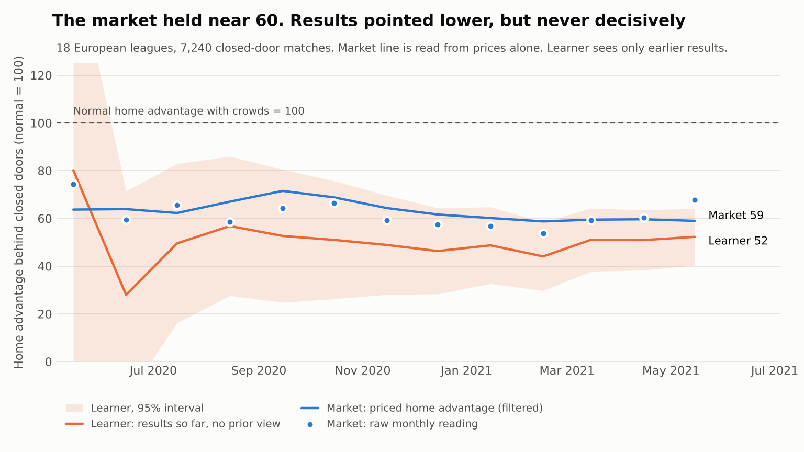

# What are fans worth?

**Home advantage, crowds, and how the betting market priced their absence.**

Covid closed football stadiums across Europe and Asia, then let fans back in stages. That is a natural experiment: the same teams, grounds and referees, with and without a crowd. This project uses it to answer one question, asked the way a betting firm would ask it:

> How much of home advantage do fans provide, how does it work, and did the market price it?

- Paper (11 pages): [`results/What_are_fans_worth_Joseph_Mace.pdf`](results/What_are_fans_worth_Joseph_Mace.pdf)
- Every result with its script: [`results/FINDINGS.md`](results/FINDINGS.md)
- Every line tried, including the dead ends: [`TRACKER.md`](TRACKER.md)
- The base model, step by step: [`MODEL_EXPLAINED.md`](MODEL_EXPLAINED.md)

## Findings

1. **Fans are worth about half of home advantage.** Closing a stadium cut home advantage to 52 on a scale where normal is 100 (95% interval 36 to 67), across 18 leagues and 7,240 closed-door matches. An independent re-derivation from the raw files, with no model, gives 54 (41 to 67).
2. **It is a switch, not a dial.** Across 29 leagues, a few hundred fans restored about as much home advantage as several thousand. Within a club in normal times, a gate 10% above or below its usual size changes nothing. The step shape was tested against a rule written down in advance and passed.
3. **Teams and referees both changed.** Without a crowd the home side's card and foul advantage disappeared, but its shot advantage only halved, in step with goals. Shots are the measure referees touch least, so a large share of the effect runs through how the teams play, not only through decisions.
4. **The market priced most of it and held its view.** Prices put closed-door home advantage at about 60 for 13 months. The market behaved like a Bayesian learner whose opening belief carried the weight of a few thousand matches (checked by simulation). Results pointed to 52, never decisively, and no learner could beat the closing price. The pre-registered "mispriced, then corrected" hypothesis failed its criteria.
5. **Clubs do not differ in home advantage beyond what is priced.** The market prices a small spread between clubs (about 8% of home advantage). Any extra true spread is too small to detect, and the out-of-sample test failed.
6. **No live edge in match odds.** Referee identity is fully priced. Two apparent edges (VAR and club home advantage) failed confirmation on data they were not found on. Both are kept in the write-up as false positives.





## Method in brief

- **Read the price, do not compete with it.** Pinnacle closing odds, margin removed, are turned into a home-strength mean and a draw width with an ordered probit. The question asked of results is narrow: was the priced home edge too big or too small when the stadium was empty?
- **Two tests, kept separate.** An information test (does a factor predict the residual against the fair price?) and a profit test (does a rule make money at the odds offered?). A factor can pass the first and fail the second.
- **Learning model.** A Kalman filter on prices alone tracks home advantage by crowd regime in each league. The market is then modelled as a Bayesian learner and its prior weight is fitted and checked by simulation.
- **Discipline.** Exploration data runs to February 2020. The hold-out (August 2021 to January 2026) was run once per test. Every test plan is written down before the test in [`analysis/`](analysis). The two analyses that turned out biased are kept in [`pipeline/traps/`](pipeline/traps) with a note saying why.

## Layout

```
analysis/   pre-registered test plans, plus the first-pass scripts
notes/      literature and how this work compares with it
pipeline/   all analysis code, in run order in pipeline/README.md
results/    findings, figures and the paper
TRACKER.md  what was explored, what was not, and where each line ended
```

## Reproducing

```
pip install -r requirements.txt
```

The data is not in the repo because it belongs to its sources.

- Match results, statistics and odds: season CSVs from [football-data.co.uk](https://www.football-data.co.uk), saved to `pipeline/fd/`, `pipeline/fd2/` and `pipeline/fd3/`.
- Attendance and referees: Transfermarkt matchday pages, fetched with `pipeline/analysis_tm_scrape.py` (England) and `pipeline/tm_any.py` (other leagues) into `pipeline/tm/` and `pipeline/tm2/`.

Then follow the run order in [`pipeline/README.md`](pipeline/README.md). Outputs go to `pipeline/work/`.

## Licence

Code is MIT licensed. The data belongs to football-data.co.uk and Transfermarkt.
